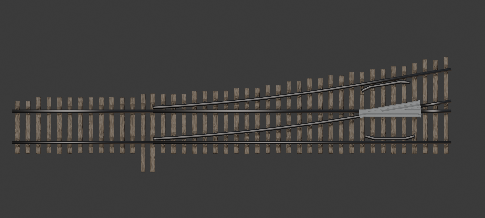
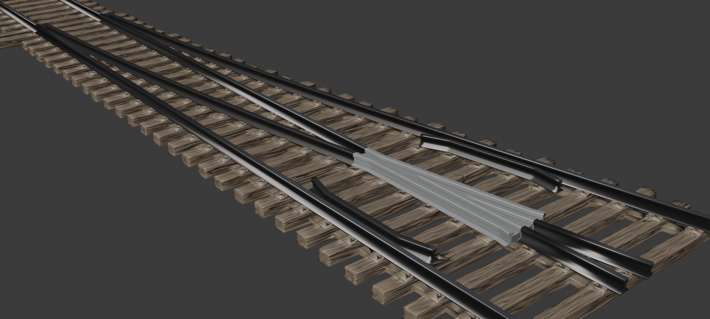

# Stub Switch Generator

A Blender 4.5+ add-on that builds 3D-printable model railroad **stub switches** (stub turnouts), the way Tie Strip Generator builds plain track: weathered ties of every length the turnout needs, joined by low connectors, with optional tie plates (slide plates under the movable rails), spike holes or printed spikes, and optionally the rails and the frog laid on top. The tie strip exports as an STL in millimetres.



## Requirements

All four add-ons are installed and enabled:

- **Weathered Board** 0.1.5 or later. It makes every tie, from your template tie.
- **Switch Frog Generator** 1.0 or later. The frog preset sets the turnout's angle (frog number), the flangeway and the rail; with Include Frog it also builds the frog.
- **Model Rail Generator** 1.0 or later. It supplies the frog preset's rail profile and sweeps the rails for Include Rail.

## Install

In Blender, open Edit > Preferences > Get Extensions, choose "Install from Disk" in the menu at the top right, and pick `dist/stub_switch-0.13.0.zip`. The panel is in the 3D Viewport sidebar (N), **Stub Switch** tab.

## Use

The **i** button in the Stub Switch panel's header turns the informational lines (summary, sizes, hints) on and off, so you can see just the settings. Errors and warnings are always shown.


1. **Make the template tie.** In the Weathered Board panel, set a standard tie's prototype size (for example 8' 6" x 9" x 7" for HO mainline) and its look, and click Add Board. (Or save it as a Weathered Board preset.)
2. **Frog and Track.** Pick a **frog preset** from Switch Frog Generator. It sets the frog number (the angle of the turnout), the flangeway, the frog's length and the rail profile, and the scale follows it. Choose **Left Hand** or **Right Hand**, the **Movable Rail Length** (15 to 24 ft on the prototype; longer rails make a gentler, longer turnout) and the **Throw** (Auto puts the straight and diverging rail ends side by side at the headblock). **Guard Rails** are on by default: they are a little shorter than the frog (the frog reaches **Frog Past Guard Rail**, 12 in, beyond each end; or choose Custom and enter a length), and each end bends in toward the middle of the track (**Bend Length** and **Bend Angle**).
3. **Ties.** Choose **Board Object** and pick your template tie (or click the eyedropper with the board selected), or choose **Board Preset**. Its look, width and thickness are used for every tie and its length is the standard tie length. Set the spacing, how many **Approach Ties** come before the heel of the movable rails and how many **Ties Past Frog**, the **Length Step** that long ties are rounded up to (6 in on the prototype), and the **Headblock Ties**, lengthened on the switch stand side. The headblock, where the movable rails meet the fixed rails, sits on a **double tie**: the long headblock tie under the movable rails' ends and a standard tie right next to it under the fixed rails' ends, **Double Tie Gap** apart (1/2 in) and centred on the headblock. The two long headblock ties are one tie width apart by default; untick **Gap = Tie Width** to enter your own gap.
4. **Strip:** **Two Pieces** (on by default) prints the tie strip as two pieces, the movable rail section and the fixed rail section, meeting in the gap just before the double tie (or before both long headblock ties). In that gap each connector becomes a **tab** on the movable piece that fits a **socket** in the fixed piece's headblock tie, open at the bottom, so the pieces line up square and can be glued. Set the **Tab Depth** (1 mm) and the **Joint Clearance** (0.1 mm, more for FDM). The two ties at the joint get no random offset or angle, so the tabs always fit.
5. **Spikes:** Spike Holes, Printed Spikes, or None. **Tie Plates** as needed (the same era presets as Tie Strip). Tie plates sit on top of the ties, a little narrower than the tie, so some tie shows on each side of every plate: a plate wider than that (about 76% of the tie width, after allowing for the worn tie edges) is narrowed to fit, and the Summary shows the width used. Under each plate a hidden footing, set in from the tie's sides, fills the wood grain so the plate prints solidly joined to the tie. The headblock plates and throw stops sit on the ties the same way.
   **Headblock** (separate from the tie plates, so it works with or without them): The headblock is one unit on each side of the track, centred on the double tie. **Headblock Plates** put a plate across both ties of the double tie under each pair of rail ends (straight and diverging, side by side). Over the standard tie, L-shaped clips run along the inside and outside of the pair, with lips that reach over the rail feet and hold the rail ends in line; the clips use the printed spike sizes in the Spikes panel. The movable rail tips slide on the plate over the long tie. With tie plates on, the headblock plate is as thick as the tie plates; with them off, both ties of the double tie are made thinner by the plate's thickness so all the rails lie level. **Throw Stops** put a block on each side of each movable rail over the long tie, standing on the headblock plate (or, with the plate off, on the tie on bolted bases), just clear of the rail foot at both ends of its travel, so the rails can't be pushed past either route. Tick **On Every Movable Tie** to also put a bolted throw stop on the outside of each movable rail on every tie under the movable rails, from the heel to the headblock, set to the rail's travel at that tie (the stops on the headblock unit stay on both sides of the rail). With **Bolts** on (the default), hex bolt heads fasten the hardware to the ties: two per tie at each end of each headblock plate, past the clips and stops, and two on a thin base plate under each throw stop that stands on its own. Set the **Bolt Head Size** (across the flats, 1-1/2 in) and **Bolt Head Height** (3/4 in).
6. **Rail and Frog:** tick **Include Rail** to lay all the rails (set for the straight or diverging route) and **Include Frog** to lay the frog, both parented to the tie strip, to check the fit and for renders. With **Frog Heel Rails** on (the default), each route leaving the frog's heel starts with a short rail as long as the guard rails, so the frog and its heel rails can be laid as one piece; the rest of the rail carries on from there. **Guard Rail Brackets** (on by default) bolt each guard rail to its running rail (Guard L to Outer L, Guard R to Stock R) through filler brackets between the rail webs, spread along the guard rail's straight part (**Brackets**, 2 each; **Bracket Length**, 18 in). Each bracket has two bolts: a rounded bolt head on the field side of the running rail, and a washer and hex nut on the guard rail's track-centre side. The bracket, washers and nuts are part of the guard rail object and the bolt heads part of the running rail, so they export with them. The brackets stay under the rail heads and below the deepest wheel flange in the flangeway (**Flange Depth**: 0 uses the NMRA RP-25 depth for the scale, 0.71 mm in HO), with 0.1 mm to spare, so they never touch a flange.
7. **Generate Stub Switch** and check the Summary. **Include Frog** also adds the guard rails, even with Include Rail off.
8. **Export STL.** The export choices are in the file browser's side panel. The tie strip is always written as two files, the movable rail section and the fixed rail section, ending `_movable` and `_fixed`:
   - **Entire Switch:** the fixed section's file holds its ties together with all the fixed rails, the guard rails and the frog; the movable section's ties are in their own file, and each movable rail is a file of its own (`..._Movable_L.stl`, `..._Movable_R.stl`). Needs Include Rail.
   - **Tie Strips Only:** just the two tie strip files. With **Include Frog and Guard Rails** (on by default, needs Include Frog) the frog and guard rails go in the fixed section's file, so you can lay your own rail.
   - **Every Object to Its Own File:** the two tie strip sections, each rail, each guard rail and the frog, each in a file of its own, named after the file name chosen plus the part (for example `..._Frog.stl`, `..._Guard_L.stl`).

   A turnout generated in one piece (Two Pieces off) has a single tie strip file ending `_ties`.

Each Generate adds a new turnout at the 3D cursor with a new random seed, as in Tie Strip; Lock Seed repeats one and rebuilds faster. The first build takes a while because every tie is its own weathered board (about 5 s per HO tie); for big turnouts, Build Options can share boards between ties of the same length. Whole setups can be saved as switch presets from the menu at the top of the panel.

## How the turnout is laid out



- **Movable rails.** A stub switch has no points. From the **heel** (where they are last spiked) to the **headblock** the two approach rails are free; they bend sideways like a cantilever to line up with either the straight rails or the diverging rails, which both end square at the headblock, one **throw** apart. The bend gives the **switch angle**, atan(1.5 x throw / movable rail length). These rails sit on slide plates and get no spikes.
- **Lead curve.** The diverging rails start at the headblock at the switch angle and curve (a circular arc) until they reach the frog angle at the frog's toe; the frog is straight, as on the prototype. The Summary shows the distance from the headblock to the frog point and the lead curve's radius.
- **Frog.** Its theoretical point sits where the inner diverging rail's gauge line crosses the straight route's rail. Ties, plates and spikes allow for its rails; a frog with a fill or base plate gets no spikes underneath.
- **Guard rails** sit one flangeway inside the running rails opposite the frog. By default the frog reaches a little past each end of them, and their ends bend in toward the track centre to lead wheel flanges into the flangeway.
- **Connectors** run under the straight and diverging rails between the ties; where the diverging rails leave the straight ones, connectors that would leave a thin wedge-shaped gap between them merge into one wider connector.
- **Ties** are square to the straight route, lined up on the straight side, with a double tie under the headblock, and each reaches as far past the outermost rail as a standard tie does past its rail, rounded up to the length step. **Tie plates** merge where rails are close (headblock, frog, guard rails), and **shoulders** follow the angled rails. **Spikes** are turned with their rail and left out where they would land on another rail.

## Files

| File | What it does |
| --- | --- |
| `geom2d.py` | Plan-view polylines: arcs, offsets, clipping. Plain Python |
| `turnout.py` | The stub switch's rails: movable rails, lead curve, frog place, guard rails. Plain Python |
| `guard_hardware.py` | Guard rail brackets, washers, nuts and bolt heads. Plain Python |
| `layout.py` | Ties, connectors, tie plates, shoulders, spike holes and printed spikes. Plain Python |
| `meshgen.py` | Boxes, prisms, hole cutters, printed spikes and tie placement as numpy arrays. Plain Python |
| `plates.py`, `scales.py` | Tie plate presets and scales. Plain Python |
| `wb_bridge.py` | The template tie; builds, simplifies and caches boards with Weathered Board |
| `frog_bridge.py` | Reads frog presets and the rail profile; builds the frog with Switch Frog Generator |
| `build.py` | Builds the objects (Manifold booleans), the rails and the frog, and exports the STL |
| `properties.py`, `operators.py`, `ui.py`, `prefs.py` | Settings, buttons, the sidebar panel and the preferences |
| `preset_store.py` | Saved plate and switch presets (JSON) |

Run the tests without Blender from this folder (the frog preset test uses the sibling `RAIL` and `SWITCH FROG` folders):

```
python -m unittest discover -s tests -t .
```

Make the install zip with `python build.py`.
